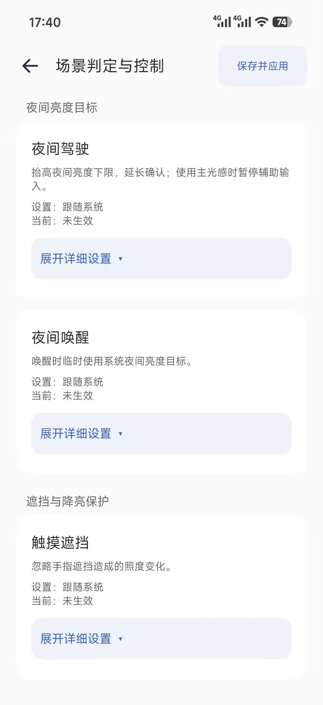
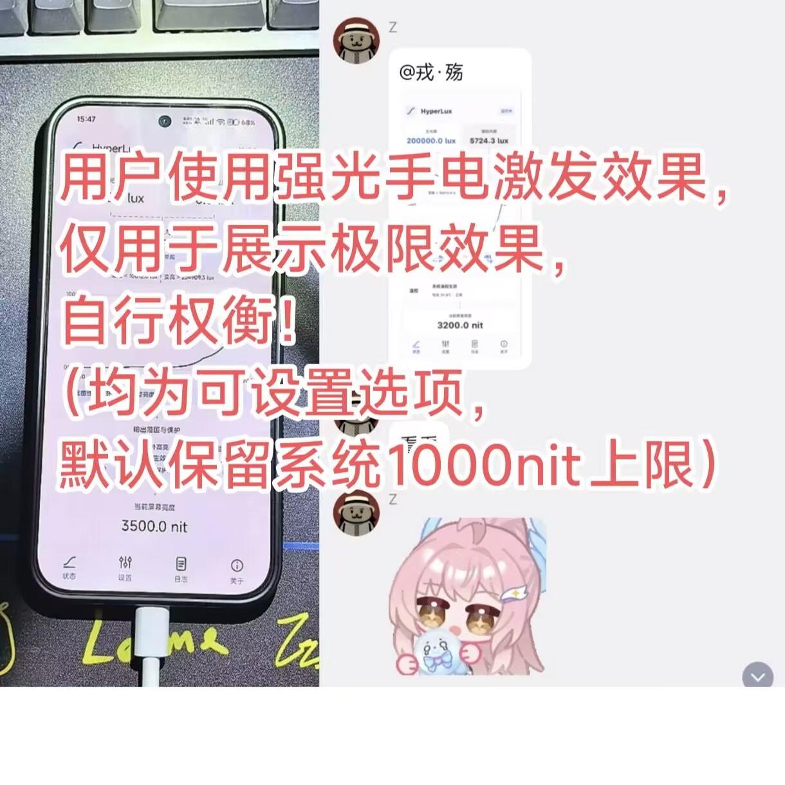

# HyperLux



兼容 HyperOS 的亮度自定义工具。基于 Root 与 LSPosed，在系统亮度链路内调整曲线、手动偏好记忆及现有场景控制，保留系统过渡动画与必要保护。



A brightness customization module for HyperOS, powered by Root and LSPosed. Customize the base brightness curve, remember manual preferences, and configure existing system scenes while retaining system transitions and protection.



## 4.1.0 正式版 / Release

1. 新增快速设置，回答6个简单问题，选择更符合自己习惯的亮度方案。
2. 完善小米 MIX Fold 3 等折叠屏的内外屏亮度调节和户外高亮适配。
3. 改善部分设备的亮度过渡设置，可分别调整变亮、变暗速度。
4. 优化更新日志弹窗，缩小占屏高度，修复底部按钮显示不完整；调整暗光设置顺序和兼容状态说明。
5. 补充温控预设，覆盖更新保留已有设置。

[完整更新日志](https://github.com/RongShangs/LumaCurve/blob/v4.1.0/docs/releases/4.1.0.md)

本次为4.1.0同版本修订（构建release-4.1.0-r1），版本名称及代码不变。已安装首发4.1.0的用户请手动下载覆盖，保留原设置。

## 功能 / Features



- 可编辑基础曲线、命名预设与手动偏好记忆。

- 状态页展示主辅光感、当前场景、生效曲线、输出保护及实际屏幕亮度。

- 九类现有场景支持参与方式、附加进入条件及进入/退出确认。

- 可选暗光稳定、暗光锁定、户外增强与显示层温控调整。

- 主屏手动亮度磁贴、平滑过渡与变化确认。

- 更新支持忽略版本、官网与 GitHub 下载；日志页可导出故障分析包。



## 界面预览 / Screenshots



<table>

  <tr>

    <th>状态页</th>

    <th>场景判定与控制</th>

    <th>户外高亮</th>

  </tr>

  <tr>

    <td></td>

    <td></td>

    <td></td>

  </tr>

</table>



### 用户强光效果示例



用户提供的强光手电演示，仅展示特定设备与设置下的效果，不代表日常亮度或所有机型的亮度上限。实际输出取决于本机映射、配置和系统保护。








## 安装 / Installation



需要 **HyperOS、Root、LSPosed**，最低 Android 14。安装 APK，在 LSPosed 启用 HyperLux，作用域选择 **系统框架 / Android 系统（android）**，重启后进入 APP 授予 Root。后续修改曲线及参数无需重启；更新模块后重启加载新版钩子。旧亮度模块请先停用或卸载，避免同时控制。



Requires **HyperOS, Root and LSPosed**, with Android 14 or newer. Install the APK, enable HyperLux for **System Framework / Android System (android)** in LSPosed, reboot, and grant Root to the app. Reboot after module updates; ordinary curve and parameter edits do not require a reboot. Disable or uninstall other brightness modules first.



## 兼容性与反馈 / Compatibility and feedback



已修复部分红米机型（K90PM / K80PM）偶发唤醒、解锁卡死的问题。修复完成的结论依据后续用户测试反馈。其他异常请在恢复使用后从日志页导出分析包，并附机型、系统版本、模块版本及故障时间；分析包可能包含设备信息，建议私下提供给作者。



The Redmi wake/unlock freeze fix is recorded based on follow-up user testing. For other issues, export an analysis package from the log page and report your device model, system/module versions and the time of the issue. Host and firmware checks do not replace testing every device.



## 源码、反馈与许可 / Source, support and license



本仓库用于 LSPosed 模块分发。完整源码继续在原仓库维护；GPL-3.0，官方版本永久免费。



This repository distributes the LSPosed module. Full corresponding source is maintained in the original project under GPL-3.0.



- [官网与下载 / Website](https://lc.rongshangs.top)

- [完整源码 / Source code](https://github.com/RongShangs/LumaCurve)

- [4.1.0 对应源码 ZIP / Corresponding source](https://github.com/RongShangs/LumaCurve/releases/download/v4.1.0/LumaCurve-4.1.0-source.zip)

- [更新日志 / Changelog](https://github.com/RongShangs/LumaCurve/blob/v4.1.0/docs/releases/4.1.0.md)

- [问题反馈 / Issues](https://github.com/RongShangs/LumaCurve/issues)

- [GPL-3.0](https://github.com/RongShangs/LumaCurve/blob/v4.1.0/LICENSE)



作者 / Author：戎Shang（RongShangs）。个人开源项目，与小米、红米及 HyperOS 官方无关联。

